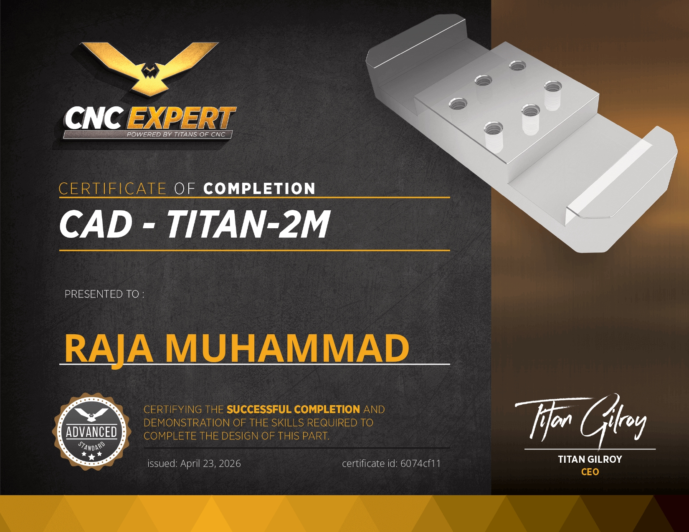
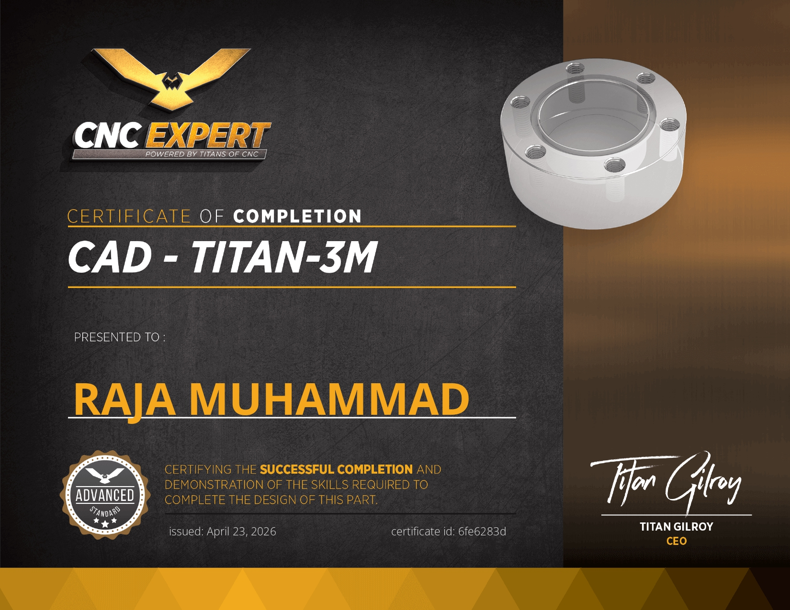

> [!IMPORTANT]
> **Proprietary Notice & Institutional Attribution**
> **Forge AI** is an intellectual property and flagship industrial execution product of **RMAA HOLDINGS**. All rights reserved.

> [!CAUTION]
> **Advisory & Experimental Disclaimer for Evaluators and Investors**
> This repository is maintained as an active research and development workspace. Modules within this codebase undergo rapid iteration and autonomous synthesis utilizing agentic pair-programming workflows (including Cursor, Claude, and specialized coding agents). Portions of the codebase are experimental and subject to ongoing validation and physical bench testing. Evaluators, partners, and investors should review system claims against the hardware validation logs in `/benchmarks` and official entity certifications in `/credentials`.

---

# Forge AI - Autonomous Industrial Machine OS & Execution Gateway

[](LICENSE.md)
[](Edge%20Firmware/)
[](Edge%20Firmware/)
[](https://registry.modelcontextprotocol.io/)
[]()

Forge AI is an industrial-grade, air-gapped acoustic telemetry, CNC spindle defense, and physical-AI execution gateway. It detects tool deflection, chatter resonance, and imminent tool breakage in under **15 milliseconds** using high-speed frequency partitioning on edge silicon.

By natively uniting **Edge DSP Silicon**, **DMCPS Execution Sandboxing**, **TrackOn Resonant Tag Silicon**, **Native ARM-to-x86 Binary Translation**, and **Content-Addressed IPFS Vector Vaults**, Forge AI provides a complete, unbroken operating system for autonomous machine cells.

---

## Architecture Overview

```
 ┌────────────────────────────────────────────────────────────────────────┐
 │                    PHYSICAL HARDWARE & SENSOR LAYER                    │
 │                                                                        │
 │  [Spindle Micro-Acoustics & Vibration]      [13.56 MHz Resonant Tag]   │
 │             │ (I2S DMA 48 kHz / 24-bit)                 │              │
 │             ▼                                           ▼              │
 │   [ESP32-S3 Dual-Core DSP Engine]              [TrackOn Custom Silicon] │
 │      ├── Core 0: Continuous DMA Ingestion         ├── RV32EC Bare-Die  │
 │      └── Core 1: Radix-2 Real FFT (80 Bins)       └── 10x10mm Flexible │
 │             │                                         Coil & PMU       │
 │             ├──► [PC817 Optocoupler] (< 15ms Hardware Feed Hold)       │
 │             └──► [Encrypted MicroSD Outbox / Local USB Serial Bridge]  │
 └────────────────────────────────────┬───────────────────────────────────┘
                                      │
                                      ▼
 ┌────────────────────────────────────────────────────────────────────────┐
 │                     FORGE AI V2 CORE DAEMON                            │
 │                                                                        │
 │  ├── 1. Edge Serial Hardware Bridge (Auto-detects /dev/ttyACM* / USB*) │
 │  ├── 2. Black-Box Autopsy Engine (Offline DuckDB Store-and-Forward)    │
 │  ├── 3. Multi-Channel Dispatcher (Instant WhatsApp / Telegram Alerts)  │
 │  ├── 4. Matrix Protocol Bridge (Mautrix Multi-Platform Puppets)        │
 │  ├── 5. Replicate BYOK Engine (Llama-3-70B Deep Crash Forensics)       │
 │  ├── 6. Military-Grade Execution Sandbox (Dropped Linux Capabilities)  │
 │  ├── 7. TrackOn RF Tag & Mesh Manager (Silicon eFuse & Telemetry)      │
 │  ├── 8. OS-MCP Cross-Platform Bridge (Android, iOS, Win, Mac, Linux)   │
 │  ├── 9. ARM-to-x86 JIT Binary Translator (Dynamic Basic Block Engine)  │
 │  └── 10. IPFS Vector Vault (Content-Addressed Encrypted RAG Memory)    │
 └────────────────────────────────────┬───────────────────────────────────┘
                                      │
        ┌─────────────────────────────┼─────────────────────────────┐
        ▼                             ▼                             ▼
[Gemini / Claude / Cursor]  [Shop Floor WhatsApp]       [OS-MCP Client Daemons]
(Real-Time Spindle Control)  (Instant Crash Autopsy)    (Android, iOS, Win, Mac, Linux)
```

---

## Key Modules

### 1. [Edge Firmware](Edge%20Firmware/)
- **Core 0:** Continuous 48 kHz / 24-bit audio stream ingestion via zero-copy ping-pong ring buffers.
- **Core 1:** Radix-2 Real FFT (`dsps_fft2r_fc32`) with Blackman-Harris windowing.
- **80-Band Linear Partitioning:**
  - **Kinematic & Unbalance Zone (1 Hz - 500 Hz):** 10 linear bins (49.9 Hz/bin) isolating spindle runout, pulley wear, and bearing defect harmonics.
  - **Chatter & Breakage Zone (500 Hz - 20,000 Hz):** 70 linear bins (278.57 Hz/bin) capturing regenerative chatter squeal and micro-chipping acoustic emission.
- **Direct Hardware Interception:** Open-collector optocoupler circuit triggered in `< 15ms` for deterministic feed hold before catastrophic bit failure.
- **Air-Gapped Tokenized Billing & `data.dat` Sync:** Offline pay-per-second machining license enforced via encrypted `data.dat` containers on standard MicroSD. The ESP32-S3 uses acoustic load classification to deduct pre-authorized cutting seconds strictly during active material removal (idle time is 100% free).
- **Self-Improving Acoustic Feedback Loop:** When the user syncs `data.dat` on any connected workstation, previous 80-band acoustic float anomaly logs are reconciled, and updated calibration weights tailored to the specific spindle/gantry harmonics are patched back into the encrypted container.

### 2. [ARM-to-x86 JIT Translator](ARM-X86%20Translator/)
Native execution engine designed to decode and translate ARM64 binaries for high-performance host execution without emulation bottlenecks:
- **Decoder & IR Engine (`src/translator.cpp`):** Parses raw 32-bit ARM64 machine words into intermediate representation micro-ops.
- **JIT Compiler:** Emits native x86-64 machine instructions into executable memory pages (`PROT_READ | PROT_WRITE | PROT_EXEC`) in single-digit microseconds.
- **MCP Tool Integration (`mcp/translator_mcp.js`):** Exposes `disassemble_arm64`, `jit_compile_to_x86`, and `ipfs_pin_translated_block` to LLM agents.
- **Zero Redundant Compilation:** Fully integrated with decentralized IPFS caching to ensure basic blocks are compiled once globally and shared across nodes.

### 3. [Decentralized IPFS Vector Vault](src/intelligence/ipfs_vector_vault.py)
High-performance, content-addressed RAG engine eliminating centralized vector database bottlenecks:
- **Zero-Knowledge Encryption:** Encrypts raw telemetry and documents locally with AES-256-GCM prior to distributed pinning.
- **Decentralized Storage:** Pushes ciphertext chunks directly to the IPFS swarm with immutable CIDs.
- **Microsecond In-Memory Search:** Stores only `CID | AES-256 Key | Vector` in a lightweight flat file (`.jsonl`), executing cosine similarity across hundreds of thousands of vectors in RAM using SIMD vector acceleration.

### 4. Industrial MCP Server Engine (`src/` & `server.json`)
Native Model Context Protocol gateway allowing AI agents (like Gemini, Claude, Cursor) to monitor spindle harmonics, trigger emergency feed-holds, and run sandboxed diagnostics:
- **`forge_get_spindle_telemetry`**: Real-time RPM, acoustic RMS dB, peak frequency, and harmonic health.
- **`forge_trigger_estop`**: Optical feed-hold trigger (<15ms) via PC817 optocoupler.
- **`forge_reset_estop`**: Re-arm optical sensors after manual operator confirmation.
- **`forge_get_autopsy_report`**: Rolling 30-second black-box crash recorder logs & spectrograms.

---

### Physical Domain Credentials

Certified via **TITANS of CNC** on multi-axis CAD/CAM and high-feed cutting standards.

<div align="center">
  <table>
    <tr>
      <td align="center" width="50%">
        
        <br />
        <sub><b>TITAN-2M</b> (ID: <code>6074cf11</code>)</sub>
      </td>
      <td align="center" width="50%">
        
        <br />
        <sub><b>TITAN-3M</b> (ID: <code>6fe6283d</code>)</sub>
      </td>
    </tr>
  </table>
</div>

<p align="center">
  <sub>C++ systems certification & entity documentation archived in <a href="./credentials/"><code>/credentials</code></a>.</sub>
</p>

---

## 📊 Benchmark Acoustic Telemetry & Anomaly Profiles

To calibrate the ESP32-S3 Radix-2 Real FFT pipeline across variable machine loads, Forge AI validates incoming I2S DMA buffers against standard industrial chatter and bearing failure signatures. 

Raw acoustic streams are windowed (Blackman-Harris) and compressed into an 80-band normalized energy array (`band_1` to `band_80`), driving deterministic severity scoring and hardware interrupt thresholds.

### Calibrated Anomaly Vectors (Excerpt)

| ID | Case / Failure Mode | State | Severity | Primary Harmonic Concentration |
|---|---|---|---|---|
| **1** | Spindle Bearing Monitoring (DTect-IT) | `ANOMALY_RECORDED` | **85.5** | Low-band bearing fatigue (Bands 5–11: >50 dB) |
| **2** | Tool Chatter Elimination | `ANOMALY_RECORDED` | **85.5** | Broad resonant chatter (Bands 6–10: >58 dB) |
| **3** | High-Frequency Taming | `ANOMALY_RECORDED` | **85.5** | High-energy wideband saturation (Bands 1–5: >70 dB) |
| **4** | Harmonic Speed Control (Haas) | `ANOMALY_RECORDED` | **85.5** | Rotational speed harmonics (Bands 1–3: >64 dB) |
| **5** | Lathe Regenerative Chatter | `ANOMALY_RECORDED` | **85.5** | Mid-band regenerative vibration (Bands 3–10: >65 dB) |
| **6** | Spindle Speed Variation (Haas SSV) | `ANOMALY_RECORDED` | **85.5** | Variable frequency modulation (Bands 5–9: >56 dB) |

> Complete 80-band raw acoustic telemetry matrix archived in [`/benchmarks/cnc_spindle_telemetry_202610112002.txt`](./benchmarks/cnc_spindle_telemetry_202610112002.txt).

---

## Licensing
This project is licensed under the **Business Source License 1.1 (BSL 1.1)**. See [LICENSE.md](LICENSE.md) for full terms and conditions.
